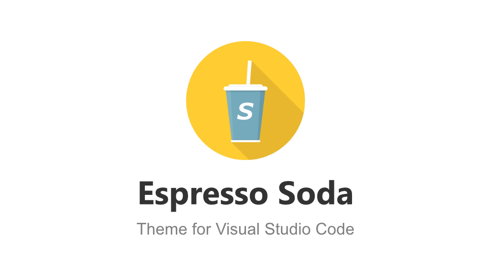
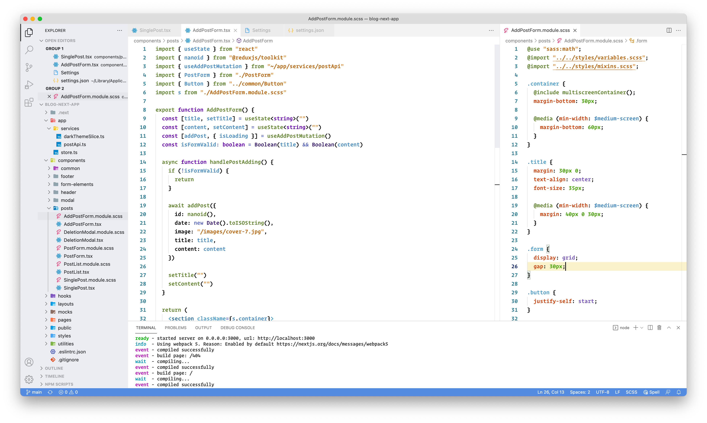
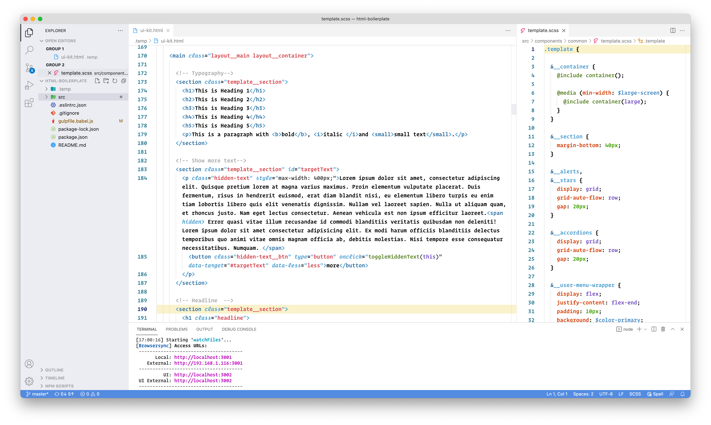
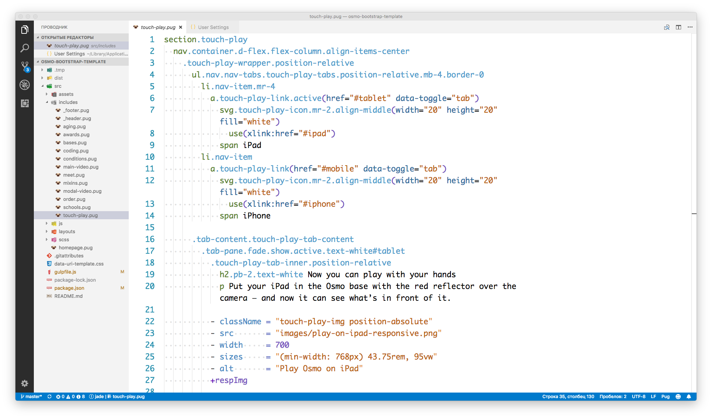

<div align="center">
</div>

Espresso Soda is a color theme for Visual Studio Code heavily inspired by the original [Espresso](https://espressoapp.com) syntax theme and built on the foundation of the default Light theme.  [Solarized Espresso Soda](https://marketplace.visualstudio.com/items?itemName=brofox86.theme-espresso-soda-solarized), which is based on the default Solarized Light theme, is also available.

## Screenshots

_React & SCSS:_<br>


_HTML & SCSS:_<br>


_Pug:_<br>


## Less syntax highlighting

I recommend installing the [better-less](https://marketplace.visualstudio.com/items?itemName=radium-v.better-less) extension together with this theme for proper Less CSS syntax highlighting in VS Code.

## Installation

This theme is available for free in the  [Visual Studio Code Marketplace](https://marketplace.visualstudio.com/items?itemName=brofox86.theme-espresso-soda-light).

### Activation

a) After install the theme, launch _Command Palette_

-  [macOS](https://code.visualstudio.com/shortcuts/keyboard-shortcuts-macos.pdf): `⇧+⌘+P`
-  [Linux](https://code.visualstudio.com/shortcuts/keyboard-shortcuts-linux.pdf): `Ctrl+P`
-  [Windows](https://code.visualstudio.com/shortcuts/keyboard-shortcuts-windows.pdf): `Ctrl+P`

b) Type `theme` and choose `Preferences: Color Theme`, then select this theme from the list.

## Customization

You can customize the colors to your liking, overriding the ones provided by this theme or extending them.
More info [here](https://code.visualstudio.com/docs/getstarted/themes).

For example, the code below in the config.json file _(Preferences > Settings)_ changes the sidebar item text color to black and make the CSS tag color dark green:

```
"workbench.colorCustomizations": {
    "sideBar.foreground": "#000000"
},
"editor.tokenColorCustomizations": {
  "textMateRules": [
    {
      "scope": ["entity.name.tag.css", "entity.name.tag.less"],
      "settings": {
        "foreground": "#61862F"
      }
    }
  ]
}
```

The scopes are identified by using _Command Palette > Developer: Inspect TM Scopes_.

## Contribution

Report issues and bugs to the [issue tracker](https://github.com/BroFox86/espresso-soda/issues).
